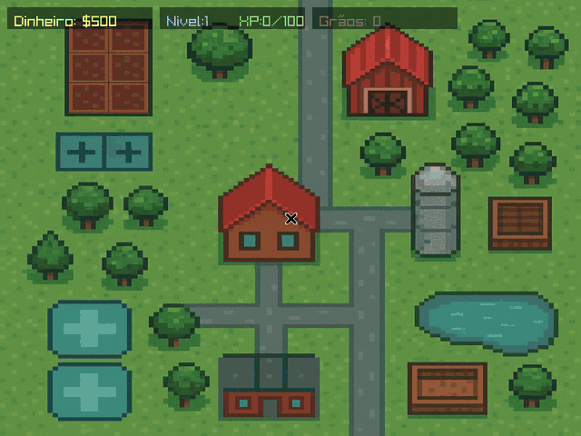
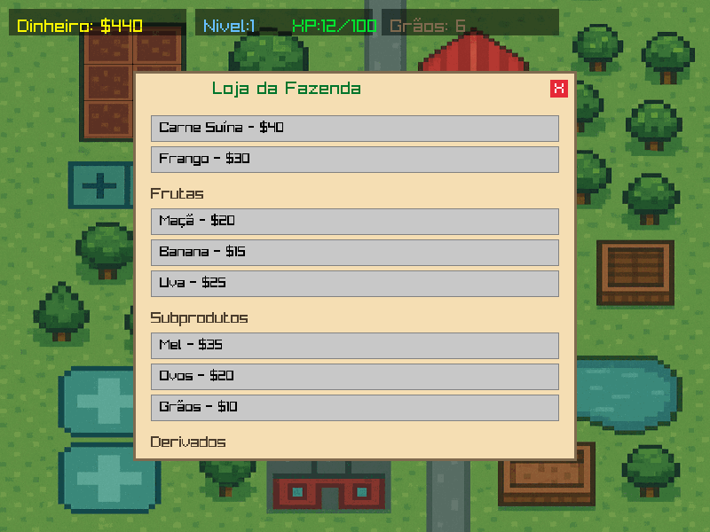
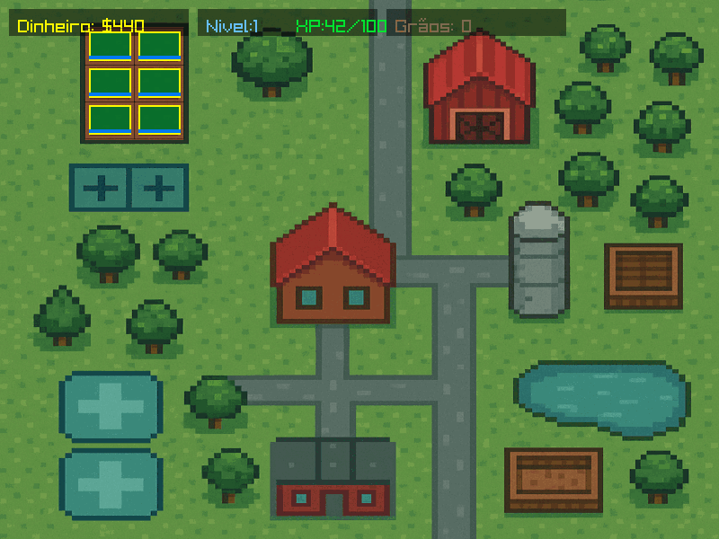
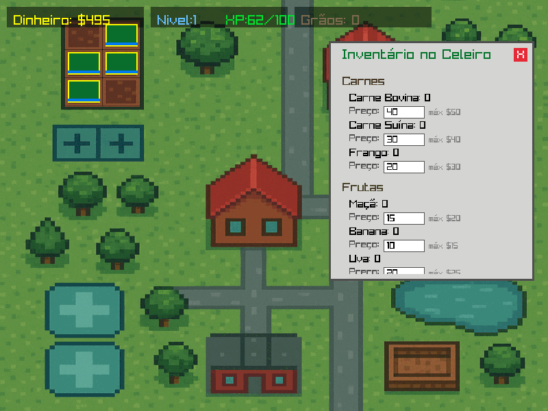

# raylib-farm

Jogo de fazenda 2D feito em **C** com a biblioteca **[raylib](https://www.raylib.com/)**. Você compra sementes no mercado, planta, espera crescer, colhe e vende no celeiro, ganhando dinheiro e subindo de nível.

Projeto da disciplina **Algoritmos e Programação**, do curso de Engenharia de Computação da UNIVASF.

**[▶ Jogar no navegador](https://lincolnarthur.github.io/raylib-farm/)** · **[⬇ Baixar para Windows / Linux](https://github.com/LincolnArthur/raylib-farm/releases/latest)**



## Como jogar

O mapa tem três lugares clicáveis:

| Lugar | O que faz |
|---|---|
| **Mercado** (prédio de baixo, no centro) | Compra carnes, frutas, subprodutos e derivados. Os **grãos** ($10) são o que dá para plantar. |
| **Plantação** (canteiros no alto, à esquerda) | Planta um grão por canteiro (6 no total). Cada planta leva 10 segundos para crescer. Quando ficar com a **borda amarela**, clique nela para colher (+$25). |
| **Celeiro** (vermelho, no alto) | Mostra o inventário. Você define o preço de venda de cada item, até o valor que pagou na loja, e vende. |

Comprar, plantar, colher e vender dão **XP**. A cada nível, a barra de XP fica 50% maior. Você também ganha $5 a cada 30 segundos, para nunca ficar sem dinheiro para recomeçar.

| Loja | Plantação pronta para colher | Celeiro |
|---|---|---|
|  |  |  |

## Baixar e jogar

Na aba **[Releases](https://github.com/LincolnArthur/raylib-farm/releases/latest)** há versões prontas, que **não precisam da raylib instalada**:

- **Windows:** baixe o `raylib-farm-windows.zip`, extraia e abra o `farmville.exe`.
- **Linux:** baixe o `raylib-farm-linux.tar.gz`, extraia e rode `./farmville` de dentro da pasta. Precisa de uma distribuição recente (glibc 2.38 ou mais nova, como Ubuntu 24.04+, Fedora 39+ ou Arch).

Mantenha a pasta `resources/` ao lado do executável, porque é de lá que o jogo carrega o mapa.

## Compilar o código

É preciso ter o **GCC** e a **raylib** instalados.

**Linux**

```bash
sudo pacman -S raylib        # Arch / CachyOS
make
./farmville
```

Em outras distribuições, instale a raylib seguindo o guia oficial [Working on GNU Linux](https://github.com/raysan5/raylib/wiki/Working-on-GNU-Linux) e depois rode `make`.

**Windows**

Instale a raylib pelo [instalador oficial](https://raysan5.itch.io/raylib), que já traz o compilador (w64devkit). Depois, no terminal do w64devkit, dentro da pasta do projeto:

```bash
make
./farmville.exe
```

Se a raylib estiver em outra pasta, informe o caminho: `make RAYLIB_PATH=C:/caminho/da/raylib`.

**Web**

A versão do navegador fica na pasta `docs/` e é publicada pelo GitHub Pages. Para gerar de novo, é preciso o [Emscripten](https://emscripten.org/) e a raylib compilada para web:

```bash
make web RAYLIB_PATH=~/raylib RAYLIB_WEB_LIB=~/raylib/src
```

## Estrutura

```
raylib-farm/
├── src/farmville.c      # todo o jogo
├── resources/
│   └── farm_map.png     # mapa da fazenda
├── web/shell.html       # página que envolve a versão web
├── docs/                # versão web compilada (GitHub Pages)
├── screenshots/         # imagens deste README
└── Makefile
```

Principais partes do `farmville.c`:

| Função | Papel |
|---|---|
| `main` | Carrega o mapa, roda o loop do jogo e decide o que cada clique faz |
| `UpdateGame` | Crescimento das plantas e renda passiva, com base no tempo do frame (`GetFrameTime`) |
| `DrawShopMenu` | Loja com rolagem (`BeginScissorMode`) e compra de itens |
| `DrawBarnPopup` | Inventário, campo de texto para o preço de venda e botão de vender |
| `DrawPlantationMenu` / `PlantCrop` / `HarvestCrop` | Plantio no grid 2×3 e colheita |
| `AddXP` | Sistema de nível e experiência |

## Histórico

- **jun/2025:** versão entregue na disciplina.
- **out/2026:** revisão para o portfólio:
  - código organizado no repositório, com Makefile;
  - plantação alinhada aos canteiros do mapa;
  - campos de preço do celeiro mostrando o preço de cada item;
  - limite no preço de venda, que antes permitia dinheiro infinito;
  - colheita com lucro;
  - versão web e executáveis prontos.

## Autor

**Arthur Lincoln Pinheiro Herculino Almeida**, Engenharia de Computação, Universidade Federal do Vale do São Francisco (UNIVASF).
